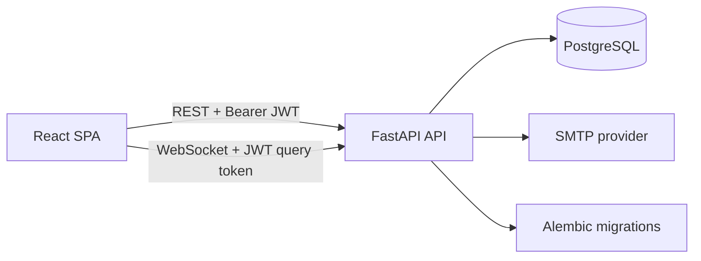

# Smart Task Management

Smart Task Management (STM) is a multi-tenant project and task collaboration
application. It provides JWT authentication, organization-scoped projects and
tasks, a Kanban workflow, analytics, notifications, realtime updates, and
profile/settings views.

## Features

- JWT authentication with protected routes
- Organization-scoped projects and tasks
- Task list, filters, pagination, and Kanban status workflow
- Task comments with author-only editing and deletion
- Analytics dashboard with Recharts
- Notification center with unread state and WebSocket updates
- Responsive navy-sidebar STM interface
- Local appearance preferences and read-only account profile

## Technology stack

- **Backend:** FastAPI, SQLAlchemy, Alembic, PostgreSQL, Pydantic
- **Frontend:** React, TypeScript, Vite, Tailwind CSS, TanStack Query, Recharts
- **Infrastructure:** Docker Compose, Nginx, GitHub Actions

## Architecture



The backend enforces organization isolation using the authenticated user's
organization. The frontend does not use fake records or client-side
organization filters.

## Repository structure

```text
app/
  api/v1/endpoints/   FastAPI routes
  core/               settings and security
  db/migrations/      Alembic migrations
  models/             SQLAlchemy models
  schemas/            Pydantic request/response schemas
  services/           business and notification services
frontend/
  src/components/     reusable UI components
  src/contexts/       authentication and realtime notification state
  src/pages/          route-level screens
  src/services/       typed API clients
tests/                backend unittest coverage
.github/workflows/    CI checks
```

## Local development

### Backend

1. Copy `.env.example` to `.env`.
2. Set a real `DATABASE_URL` and a strong unique `SECRET_KEY`.
3. Start PostgreSQL, then install dependencies and migrate:

   ```bash
   uv sync
   uv run alembic upgrade head
   uv run uvicorn app.main:app --reload
   ```

The API is available at `http://localhost:8000`; interactive documentation is
at [`http://localhost:8000/docs`](http://localhost:8000/docs).

### Frontend

1. Copy `frontend/.env.example` to `frontend/.env`.
2. Install and start:

   ```bash
   cd frontend
   npm ci
   npm run dev
   ```

The development UI is available at `http://localhost:3000`.

## Environment variables

Backend variables are documented in [`.env.example`](./.env.example):

| Variable | Purpose |
|---|---|
| `DATABASE_URL` | PostgreSQL SQLAlchemy connection string |
| `SECRET_KEY` | JWT signing secret; never commit this value |
| `CORS_ORIGINS` | Comma-separated allowed browser origins |
| `ALGORITHM` | JWT algorithm, normally `HS256` |
| `ACCESS_TOKEN_EXPIRE_MINUTES` | JWT lifetime |
| `SMTP_HOST`, `SMTP_PORT`, `SMTP_USER`, `SMTP_PASSWORD`, `SMTP_TLS` | SMTP delivery configuration |
| `EMAIL_FROM` | Sender address |

Frontend variables are documented in
[`frontend/.env.example`](./frontend/.env.example):

| Variable | Purpose |
|---|---|
| `VITE_API_URL` | Browser-visible API origin |
| `VITE_WS_URL` | Browser-visible WebSocket origin |

Vite variables are embedded at build time and must not contain secrets.

## Screenshots and UI preview

The responsive screens are available at these routes after starting the
frontend:

- `/dashboard` — analytics overview
- `/projects` and `/projects/:projectId` — project management
- `/tasks` and `/tasks/:taskId` — task management
- `/kanban` — Kanban board
- `/notifications` — notification center
- `/profile` and `/settings` — account experience

The repository currently does not include binary screenshot artifacts. These
routes provide the canonical preview surface for capturing deployment
screenshots without committing generated images.

## Testing

```bash
# Frontend
cd frontend
npm run lint
npm run build

# Backend (PostgreSQL must be available)
cd ..
uv run alembic upgrade head
uv run python -m unittest discover -s tests -p 'test_*.py' -v
```

GitHub Actions runs the same frontend checks and backend suite against
PostgreSQL for pushes and pull requests.

## Docker deployment

Set production values in an uncommitted `.env`, including `POSTGRES_PASSWORD`,
`SECRET_KEY`, `CORS_ORIGINS`, `VITE_API_URL`, and `VITE_WS_URL`, then run:

```bash
docker compose build
docker compose up -d
```

The frontend is served by Nginx on port `3000`, the API on port `8000`, and
PostgreSQL data persists in the `postgres_data` named volume. The backend runs
Alembic migrations before starting. Review the generated logs and health
checks before exposing the services publicly.

SMTP delivery is configuration-dependent. A successful SMTP connection has not
been verified in this environment, so this project does not claim that email
delivery works until a real message is received.

## Deployment requirements

Before production release:

- Use managed PostgreSQL and a strong secret manager.
- Set exact production `CORS_ORIGINS`, API, and WebSocket origins.
- Configure and verify a reachable authenticated SMTP provider.
- Put TLS/reverse-proxy protection in front of the services.
- Run migrations as a controlled release step and back up the database.
- Validate the deployed frontend, API health endpoint, authentication, and
  WebSocket notifications from the production domain.
